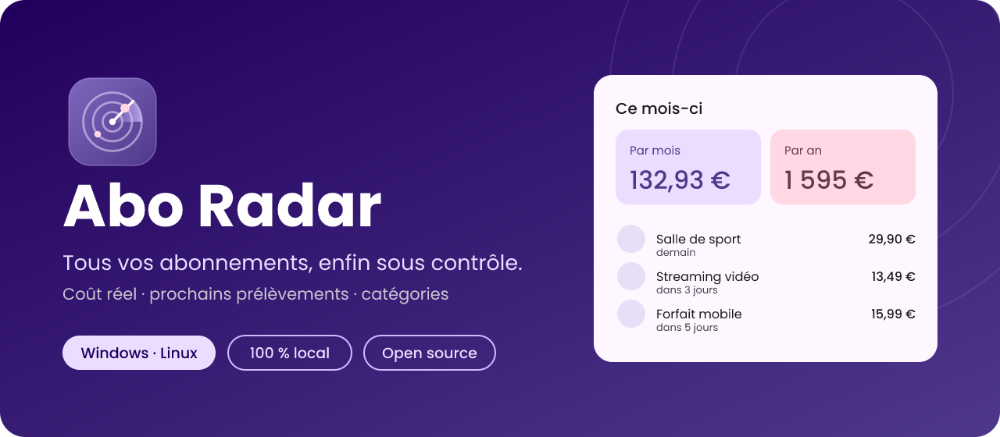
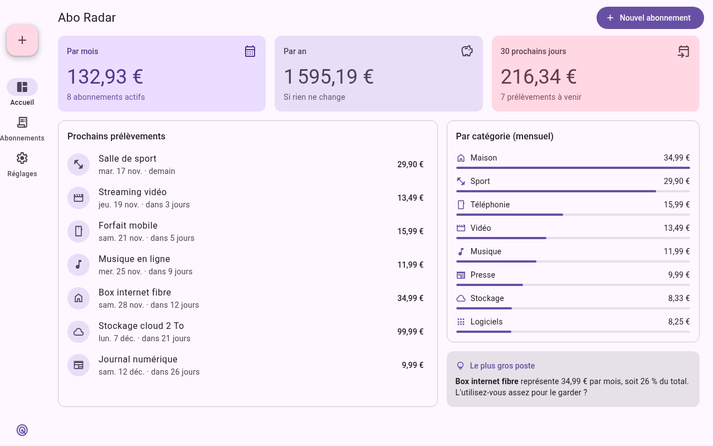
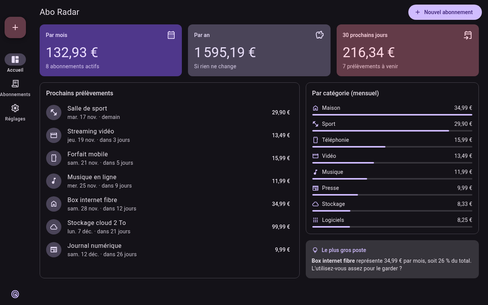
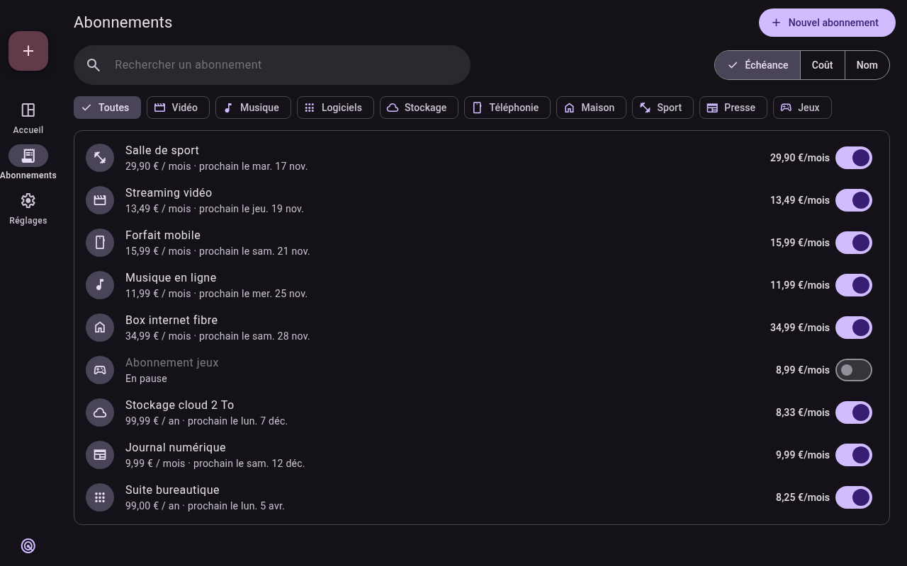
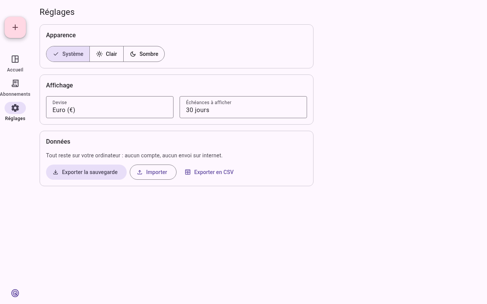

<p align="center">
  
</p>

<p align="center">
  <a href="https://github.com/JulesROGUE/abo-radar/releases/latest"></a>
  
  
  <a href="LICENSE"></a>
</p>

<p align="center">
  <b>Abo Radar</b> rassemble tous vos abonnements au même endroit et vous montre ce qu'ils vous coûtent <i>vraiment</i>,<br>
  sans compte, sans cloud et sans publicité : vos données restent sur votre ordinateur.
</p>

<p align="center">
  <a href="https://github.com/JulesROGUE/abo-radar/releases/latest"><b>Télécharger pour Windows ou Linux</b></a>
</p>

---

## Pourquoi

Vidéo, musique, cloud, salle de sport, box, forfait mobile, presse… Les abonnements s'additionnent sans qu'on s'en rende compte,
et les prélèvements annuels surprennent toujours. Abo Radar donne une vue claire en quelques secondes :
combien vous payez par mois, par an, et ce qui va être prélevé dans les prochains jours.

## Aperçu

<p align="center">
  
  
</p>
<p align="center">
  
  
</p>

## Fonctionnalités

| | |
|---|---|
| **Coût réel** | Total mensuel et annuel, quelle que soit la fréquence (semaine, mois, trimestre, année). |
| **Prochains prélèvements** | Les échéances des 7, 30, 60 ou 90 prochains jours, avec le montant à prévoir. Les dates se recalculent toutes seules. |
| **Par catégorie** | Vidéo, musique, logiciels, stockage, téléphonie, maison, sport, presse, jeux… et le plus gros poste mis en avant. |
| **Recherche et filtres** | Recherche, filtres par catégorie, tri par échéance, coût ou nom, mise en pause d'un abonnement. |
| **Vos données chez vous** | Aucun compte, aucun envoi sur internet. Sauvegarde et import en JSON, export CSV pour un tableur. |
| **Material You** | Interface Material Design 3, thème clair, sombre ou celui du système. |

## Installation

Rendez-vous sur la page des [versions](https://github.com/JulesROGUE/abo-radar/releases/latest) :

- **Windows** : `Abo.Radar-Setup-x.y.z.exe` (installeur) ou `Abo.Radar-x.y.z-portable.exe` (sans installation).
- **Linux** : `.AppImage` (rendez-le exécutable puis lancez-le) ou `.deb` pour Debian / Ubuntu (`sudo apt install ./fichier.deb`).

> L'exécutable Windows n'est pas signé : au premier lancement, SmartScreen peut afficher « Windows a protégé votre ordinateur ».
> Cliquez sur **Informations complémentaires** puis **Exécuter quand même**. Le code source complet est ici, et les fichiers sont compilés par GitHub Actions.

## Développement

```bash
git clone https://github.com/JulesROGUE/abo-radar.git
cd abo-radar
npm install
npm start          # compile l'interface et ouvre l'application
npm run dist       # crée les paquets pour votre système dans release/
```

| Couche | Outils |
|---|---|
| Interface | React 19, Vite, composants Material You (Material Design 3) |
| Application | Electron (fenêtre isolée, sans accès Node depuis la page) |
| Paquets | electron-builder : installeur NSIS et portable Windows, AppImage et .deb Linux |
| Releases | GitHub Actions, déclenchées par un tag `v*` |

## Licence

[MIT](LICENSE) © Jules ROGUE. Icônes : [Material Symbols](https://fonts.google.com/icons) (Apache 2.0). Police : Roboto (OFL).
